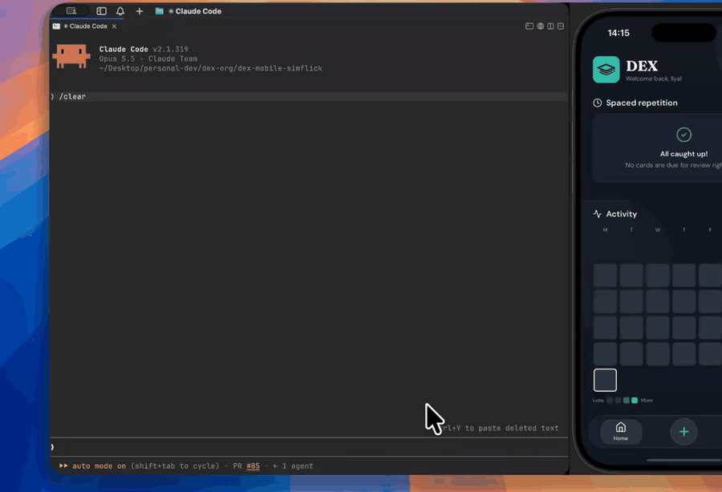

# simflick

Fast UI driving for iOS simulator apps, built for AI agents (in the spirit of
[jev-ultrafast](https://github.com/browser-use/jev-ultrafast), but for the iOS simulator).

<a href="docs/demo.mp4"></a>

## What it is

simflick is a small library that gets injected into an iOS simulator app at launch, wrapped in a CLI. From inside the app it reads what's actually on screen (visible elements, their text and tap points,
scroll areas, popups, web view content) in ~25 ms, and acts on it: taps, swipes and typing go through the app itself, not through the simulator from outside.

On top of that sits a loop: inspect the UI, let a decision model pick the next action, execute it, repeat. By default the model is TypeSafe's Jev (~200 ms per decision), but the loop doesn't care who decides — any model, or an agent like Claude Code calling `simflick screen` / `tap` / `type` itself.

## What you'd use it for

- **Letting a coding agent test what it just built.** Claude Code changes a screen, then runs `simflick run "<what to check>" --steps "<plan>"` and verifies the end state from a screenshot. The agent plans and checks; simflick does the fast clicking.
- **End-to-end checks without writing test scripts.** A goal plus a step list instead of a Maestro YAML file with test ids and waits.
- **Reproducing a bug or reaching a deep screen fast**, e.g. "open the third deck, practice it, swipe two cards left".
- **Demos and screen recordings** of a flow, at real speed.

### How fast

Measured on [Dex](https://dex.cards), my flashcard app: React Native + Expo, live on the App Store,
with its own Maestro suite of 17 end-to-end flows. Same flow for every tool (Profile → Language →
Spanish → check → English → check), same simulator (iPhone 16 Pro, iOS 18.6), app already open on Home:

| Driven by | Time | What it needs |
|---|---:|---|
| **simflick** (`run` + `--steps`) | **10.8 s** | A goal and a step plan in plain English |
| Maestro | 34–38 s per run<br>(~15 s flow + ~23 s driver startup) | A YAML flow with test ids and waits |
| AXe, scripted (no model) | 34–37 s | A script with test ids; each screen read 1–2 s, each tap ~1.3 s |
| Claude Code driving AXe step by step | 68 s | Nothing up front; one model turn per step |

The Claude Code row is a best case: it already knew the test ids and merged two steps.

## Quick start

```sh
npm install -g github:da22le123/simflick       # builds the library and the CLI on install
mkdir -p ~/.config/simflick && chmod 700 ~/.config/simflick
echo 'TYPESAFE_API_KEY=...' > ~/.config/simflick/env && chmod 600 ~/.config/simflick/env

simflick launch com.example.app --udid <UDID>  # relaunches the installed app with the library injected
simflick screen                                # what the agent sees
simflick run "Add a deck 'Demo' and practice it" \
  --steps "tap +; choose Deck; type 'Demo' as the title; tap Create Deck; open the deck 'Demo'; swipe right ×2" \
  --shot
```

Needs Xcode (simulators, clang) and Node ≥ 18. The app has to be installed on the simulator already.
[AXe](https://github.com/cameroncooke/AXe) (`brew install cameroncooke/axe/axe`) is used for iOS system alerts
and as a fallback; everything else happens inside the app.

## Writing a run

- **Pass `--steps`.** The decision model picks one action at a time; it doesn't hold a plan or count. Steps are
  followed in order and `×N` steps (`swipe right ×2`) are counted by code.
  In our tests this took a counting goal from 1 pass in 3 to 4 in 4. End the plan with a step that checks the
  result (`the completion screen says 'Great work!'`), since the run stops when the last step is done.
- **Quote what to type** inside the step: `type 'Hola' into card 1 back`.
- **Name the route** if you know the app: `open Materials; open the folder 'German'; ...`. A screen that merely
  mentions a word attracts the model.
- **Start from a clean state** (a fresh session, an empty search) or the run sees leftovers from the last one.
- **Block what must never be tapped:** `--never "Delete account,Sign out"`.
- **Check the end state yourself.** `DONE` is the model's claim; `--shot` saves a screenshot, and the trace says why.

## Using it from Claude Code

[`skills/simflick/SKILL.md`](skills/simflick/SKILL.md) is a Claude Code skill: link it into `~/.claude/skills/`
and Claude Code knows how to launch, plan with `--steps`, verify and read traces. Put app-specific notes (bundle id,
port, test account location, a map of the screens) in the app's repo as `.simflick/README.md`; the skill reads it first.

## CLI

```sh
simflick launch <bundle-id> [--udid U] [--port P] [--lang de]
simflick screen [--json]                   # numbered elements, scroll areas, page text
simflick tap <n|testID|x,y> [--screen]
simflick scroll <S0|testID> <up|down|left|right> [--amount 0.6]
simflick swipe x1,y1 x2,y2 [--ms 300] [--fling]
simflick type "text"                       # into the focused field; refuses if none is focused
simflick wait                              # until the screen stops changing
simflick run "<goal>" [--steps "a; b ×2; c"] [--shot] [--never "A,B"] [--max-steps 60] [--full-trace]
```

Every action waits for the screen to settle: nothing animating or moving, no spinner, no change for 150 ms.
`run` writes a trace to `~/.simflick/runs/<time>.json` after every step: what was on screen, what the model was
offered, and its top choices with probabilities.

Keys are read from the environment, then from `~/.config/simflick/env`. `TYPESAFE_API_KEY` drives `run`; for typing
values that aren't quoted in the goal or steps, `ANTHROPIC_API_KEY` or `TEXT_MODEL_API_KEY` (+ `TEXT_MODEL_BASE_URL`,
`TEXT_MODEL`). `screen`, `tap`, `scroll`, `swipe` and `type` need no keys.

## What it reads

- **UIKit, SwiftUI and React Native** in one model: buttons, links, inputs, switches with their state, sliders, rows,
  and the text around each control (which card a "Save" button belongs to).
- **Web views** (`WKWebView`): visible text and links, read from the page and clicked by script.
- **Gesture-only views** (a flip/swipe card) from their gesture recognizers, with swipe operations.
- **Lists:** what's scrolled away, and for lazy UIKit/SwiftUI lists a read-ahead of up to 5 screens.
- **Popups:** in-app alerts and sheets directly, iOS permission alerts through AXe, and controls covered by a toast.
- **Status:** progress bars and charts as text ("Upload: 40%", "Tue: 5"), screen titles, a hidden tab bar.

Not supported: UI from another process (share sheet, Safari sign-in sheets: reported as unreadable), maps beyond
plain taps and drags, and real devices.

## How it works

`inject/` is an Objective-C library loaded with `DYLD_INSERT_LIBRARIES` when `simflick launch` starts the app. It
walks the view and accessibility trees once (`SFCollect`), applies ordered rules over the result (`SFRefine`: merge
duplicates, build rows, previews), and serves JSON on `127.0.0.1`. Taps are synthesized in-process (UITouch +
IOHIDEvent, as KIF does); SwiftUI controls that ignore synthetic touches are activated through accessibility; text
goes in through UIKit's text input API. Thresholds live in `inject/SFTuning.h`.

`scripts/golden.mjs` records the reader's output on fixed app states so a change can be diffed before and after.

```sh
T=$(jq -r .session.token ~/.simflick/<udid>.json)
curl -H "X-Simflick-Token: $T" localhost:8765/screen              # ?scan=1 reads lazy lists ahead
curl -X POST -H "X-Simflick-Token: $T" "localhost:8765/tap?x=220&y=670"
```

## Security and caveats

- Simulator only. Touches use private UIKit APIs (as KIF does); if an iOS update removes one, the tap fails and
  says so instead of crashing the app.
- The library listens on `127.0.0.1` and only answers requests with the per-launch token from `simflick launch`
  (`~/.simflick/<udid>.json`, mode 600). Requests from browsers (an `Origin` header) or with a non-local `Host` are
  rejected; actions need `POST`.
- Traces in `~/.simflick/runs/` (mode 700) contain on-screen text and typed values.

## Credits

The goal loop (`simflick run`) is adapted from [jev-ultrafast](https://github.com/browser-use/jev-ultrafast)
(MIT, © 2026 Browser Use); see `NOTICE`. The in-process touch technique follows
[KIF](https://github.com/kif-framework/KIF). simflick is MIT licensed.
